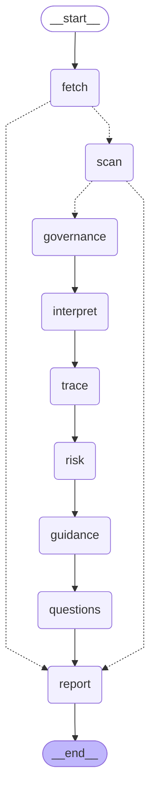

# Security Assistant: the workflow

One workflow takes a student repository from "fetch" to a report. It is a [LangGraph](https://langchain-ai.github.io/langgraph/) graph (the
`langgraph` version pinned in `pyproject.toml`, no other agent framework), and three of its parts are bounded agent loops that are graphs
of their own. The diagrams below are generated from the compiled graphs (`python -m app.agents.security_assistant.graphs.diagrams`), so
they cannot drift from the code; a test fails if a committed diagram is stale.

## The flow

<!-- diagram:workflow -->

<!-- /diagram -->

| Stage | What it does | Agent or graph | Needs the LLM | If it fails |
|---|---|---|---|---|
| fetch | clones a public https://github.com repo (or opens a local folder); names in its git history become known names for the redactor | - | no | straight to the report: nothing downstream can run |
| scan | runs the detection tools, or reviews a reused `findings.json` | **Analysis Orchestrator** (graph) | no | straight to the report |
| governance | tool allow-list, repository scan for prompt-injection indicators, the secret values to look for | **Governance** gate (graph) | no | the LLM stages are skipped, the run is INCOMPLETE |
| interpret | the LLM judges each finding; every call passes the governance gate | gate before each call | yes | `partial` / `failed` / `skipped`, the run is INCOMPLETE |
| trace | introducing commit, links to stories and tasks; link proposals pass the gate | gate before each call | for link proposals | same |
| risk | rule-based ranking, no LLM | - | no | same |
| guidance | standard fix advice per type of issue | - | no | same |
| questions | one probe question per confirmed finding, follow-ups, escalation; the Tutor is a mock | **Question Agent** (graph) | no | same |
| report | fills in the stages that did not run, lists every incomplete reason, scans the report for leaked values, writes `report.json`, `report.md`, `audit.jsonl` | - | no | - |

**Failures are never hidden.** Every path ends in the `report` node. A failed or partial stage becomes a stage status in the graph state and an
"incomplete reason"; the report starts with an INCOMPLETE banner that lists them. The edges leave the chain early only where nothing downstream
could run (nothing fetched, no scan result), and then go straight to the report, which records the other stages as "skipped, needs X". After
any other failed or partial stage the next stage runs, or records why it was skipped (a later stage that does not depend on the failed one,
such as guidance, still runs).

## How the graphs are built

- **State.** Each graph has a typed state (`AssessState`, `OrchestratorState`, `QuestionState`, `GateState`). The stage statuses of a run live in
  `AssessState.stages`; the governance score, level and history live in `GateState`, which the Governance object carries from one pass to the next.
  There is no checkpointing and no persistence: state lives for one run.
- **Nodes call the core, they do not replace it.** `agent_loop.py` (the action vocabulary, the validation of every choice, the budgets, the decision
  trail) and the audit log are the core. Each agent's code computes the actions that are valid in the current state; a policy may choose only among
  them (`agent_loop.select`). A choice outside the list is rejected, recorded, and replaced by the rule policy, inside the graph. A node never acts
  on a choice that did not pass `select`.
- **The policy is swappable.** The default is a set of deterministic rules. Anything with `choose(state, options) -> (action, reason)` can replace
  it, for example an LLM that is shown the same small state summary and the same options. No LLM policy is built.
- **Nesting.** The `scan` node runs the Orchestrator graph, the `questions` node runs the Question graph once per finding, and `interpret` and
  `trace` pass every LLM call through the Governance gate.
- **Budgets** (steps and retries) come from `LoopConfig` and the environment (`.env.example`). **Every decision** is an `agent_decision` line in
  `audit.jsonl` and a row of the "Decision trail" in `report.md` / `report.json`.

## The three agents

Each is: it **selects** its next action from a fixed list, **keeps state** between steps, and **loops** until its goal is met or its budget is spent
(see "What is not built" for where this is weaker).

### Analysis Orchestrator (`orchestrator.py`, `graphs/orchestrator_graph.py`, diagram `docs/orchestrator.mmd`)

Goal: a findings report where every category is covered and no dependency gap is open. State: tool statuses, retries, coverage, gaps, steps.
Nodes: `plan` (valid options, validated choice) -> `execute_action` -> `update_state` -> `plan` ... -> `stop`.

| Action | Valid when |
|---|---|
| `run_tools` | first pass |
| `retry_tool` | a tool failed or timed out and its retries are not spent (a missing binary is never retried) |
| `codeql_per_language` | CodeQL failed, retries spent, several CodeQL languages |
| `scan_declared` | the full OSV-Scanner run failed, retries spent, a requirements file has loose pins |
| `record_gap` | a dependency coverage gap is open |
| `skip_with_reason` | a tool cannot be run or retried |
| `stop` | always (goal met / nothing left to try / budget spent) |

### Question Agent (`questions.py`, `graphs/question_graph.py`, diagram `docs/question.mmd`)

Goal: a finding closed by the Tutor's comprehension score. State: attempts and scores per finding. Nodes: `ask` -> `score` -> (`close` |
`follow_up` -> `score` ... | `escalate`). Follow-ups come from a different angle with a higher hint level and never state the fix.

| Action | Valid when |
|---|---|
| `ask_question` | no attempt yet |
| `ask_followup` | the last score is below the threshold and follow-ups are left (default 2) |
| `close_finding` | the last score is at or above the threshold |
| `escalate_to_lecturer` | the finding is not closed (the attempt limit or the step budget is reached, or by choice) |

### Governance (`governance.py`, `graphs/governance_graph.py`, diagram `docs/governance.mmd`)

Goal: nothing that must not leave the machine is sent, and a hostile repository gets more scrutiny. State: score, level (normal / elevated / high),
history, counters. Nodes: `check_input` -> (`raise_scrutiny` -> `escalate`) -> `allow` | `block`. It never changes a verdict and never drops a
finding.

| Action | Valid when |
|---|---|
| `allow_call` | no check failed, level normal |
| `allow_after_second_check` | no check failed, level elevated or high (a second, stricter check ran) |
| `block_call` | a check failed (a secret or personal value is in the outgoing text) |
| `allow_call_warn_only` | a check failed and `--governance-warn-only` is on (recorded, not blocked) |
| `raise_scrutiny` | the score reached the next threshold (3: elevated, 6: high) |
| `escalate_to_reviewer` | the high level was reached: the run is flagged for human review |

## What is mocked or not built

| Part | Status |
|---|---|
| Tutor and the comprehension score | **Mock** (`MockTutor`, labelled in every output): no student answers anything |
| Requirements and sprint tasks | local JSON files in a documented format; the Requirements agent does not exist |
| LLM policy for the three agents | **not built**: only the rule policies; the interface is ready |
| Orchestrator wiring (`agent.py`, the agent registry), database persistence, a public webhook endpoint | **not built**: the workflow runs from the command line (`assess`) |
| Checkpointing, resuming a run | **not built** by design |
| Real CodeQL per-language and targeted OSV fallbacks | tested with scripted fake tools; not exercised against the real tools in this workflow |
| Where the "agent" part is weak | the Question Agent has no tools to choose and often only one valid option; the Governance gate is event driven and has no goal it works towards, only escalation |
| RQ1 on all four demo repositories with one model | pending (needs the Groq daily quota) |

## Tests

`tests/test_graph_*.py` test each graph (structure, happy path, rogue policy rejected inside the graph, budgets, routing of failures);
`tests/test_golden_assess.py` proves that the run output of the Python demo (saved scan, mocked LLM, mock Tutor) is identical to the output recorded
before the graphs existed; `tests/test_graph_diagrams.py` checks that the committed diagrams match the code.
