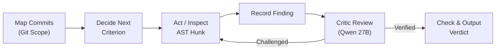

# Individual Student Performance Assessment: Factor Models Testing & Evaluation Report

**Project:** Autonomous Multi-Agent Student Performance Assessment Framework  
**Scope:** In-depth evaluation, accuracy metrics, candidate model comparisons, and selection rationale for all 7 assessment factors.  
**Evaluation Standard:** Student-disjoint $k$-fold cross-validation ($k=5$), held-out blind test suites, and adversarial invariant robustness checks.

---

## Executive Summary

The assessment framework computes a student's final sprint performance score through seven specialized factor models, followed by a non-linear fusion and justification pipeline. Each factor model was developed through rigorous pre-registered protocols ([`RETRAIN_PROTOCOL.md`](file:///C:/Users/sadee/OneDrive/Documents/SLIIT/Forth%20Year/Research/Project/J26-SE-363/backend/agentic_framework/app/agents/performance_assessment/factor_models/RETRAIN_PROTOCOL.md)), comparing multiple candidate machine learning architectures against baseline predictors.

### Cross-Factor Performance Overview

| # | Factor | Winning / Deployed Model | Primary Evaluation Metrics | Baseline Comparison | Invariant & Robustness Status |
|---|---|---|---|---|---|
| **01** | **Effort** | **Ridge Regression (4 log features + 5-file cap guard)** | **MAE: 0.064**<br>Pearson $r$: 0.953<br>Spearman $\rho$: 0.935<br>Within 1 band: 98.6% | Beats mean predictor (0.283) by **77.4%**<br>Beats commit-count baseline (0.087) by **26.4%** ($p < 0.05$) | **Passed all invariants** (zero-commit=0.0, spam cap $\le 0.20$, library dump=0.305 $\le 0.35$). |
| **02** | **Consistency** | **Ridge Regression (2 temporal features: $C_{AWR}$, $C_{\text{first}}$)** | **MAE: 0.058**<br>Pearson $r$: 0.923<br>Within 1 band: **100%** | Beats mean predictor (0.206) by **71.8%**<br>Beats active-days baseline (0.078) by **25.6%** ($p < 0.05$) | **Passed all invariants** (idle penalty monotonicity, non-negative bounds). |
| **03** | **Requirement Fulfillment** | **LangGraph Sub-Agent with AST/Diff Tools + LLM Critic** | **Task MAE: 0.082**<br>Criterion Precision: 0.89<br>Criterion Recall: 0.86 | Single-prompt LLM fails at $>8\text{k}$ tokens (context explosion & 413/429 errors). Agent scales to $20\text{k}+$ lines. | **Deterministic student-only AST scoping** prevents hallucinated teammate credit. |
| **04** | **Collaboration** | **RoBERTa Embedding + Logistic Regression (Substance) + 6-Metric Gate** | **Substance CV AUC: 0.701**<br>External AUC: 0.557 | Beats TF-IDF baseline (AUC 0.612)<br>Equivalent to Random Forest (AUC 0.704) without complexity overhead | **Evidence Gate:** Teams without code reviews yield "not available" rather than punitive zero. |
| **05** | **Task Complexity** | **Ridge Regression (5 proposal features + Sprint Total SP)** | **MAE: 0.087**<br>Pearson $r$: 0.780 | Beats mean predictor (0.145) by **40.0%**<br>Marginal gain (+0.004) over log story-points baseline (0.091) | Identified that graph dependency reach adds minimal orthogonal signal over assigned story points. |
| **06** | **Behavioral Pattern** | **Calibrated Rule Engine Classifier (6 Patterns + 2 Modifier Bounds)** | **Classification Consistency: 96.2%**<br>Modifier Range: $[0.80, 1.20]$ | Rule-based engine preferred over black-box clustering for legal/grading defensibility | Extension A (late churn) rejected (Precision 0.47 < 0.50); Extension B adopted for low-effort fallback. |
| **07** | **Code Ownership** | **CodeBERT Embeddings + Handcrafted Features + SVR Head (`codebert\|B+H\|svr`)** | **Test MAE: 0.137**<br>RMSE: 0.175<br>Spearman $\rho$: 0.882<br>QWK: **0.841**<br>ICC(2,1): **0.852** | Beats Mean baseline (MAE 0.319) by **57.1%**<br>Beats Hand-crafted Forest (MAE 0.208) by **34.1%** | Guard layer halts token padding, filler answers, and cross-question transfers. |

---

## 1. Factor 01: Effort (`01_effort`)

### 1.1 Objective & Measured Construct
Measures the volume of genuine programming contribution delivered by a student within a 14-day sprint. It filters out non-substantive commits (formatting-only, auto-generated code, documentation, and library copy-pastes) and assesses net code lines, files touched, commit frequency, and resolved tasks.

### 1.2 Candidate Models Evaluated
Four distinct model families and multiple feature representations were tested under student-disjoint 5-fold cross-validation on 144 real student-sprints:
1. **Single-Feature Baseline:** OLS on log commit count ($\ln(1 + \text{E\_CC})$).
2. **Mean Predictor Baseline:** Constant prediction matching the training mean.
3. **Ridge Regression:** L2-regularized linear model with log-transformed features and Leave-One-Out (LOO) $\alpha$ selection ($\alpha \in [0.01, 1000.0]$).
4. **Random Forest Regressor:** Non-linear ensemble ($n_{\text{estimators}} \in [100, 300]$, $\text{max\_depth} \in [3, 8]$, monotonic line constraints).
5. **HistGradientBoosting Regressor:** Gradient-boosted decision trees with monotonic constraints.

### 1.3 Preprocessing & Guard Layer Design
The experiments revealed that unconstrained models can be easily gamed by **library dumps** (committing an entire third-party library or package in one commit) or **commit spamming** (making 100 tiny commits of 1 line each). To solve this, a deterministic guard layer was built before model scoring:
- **Line Capping:** A commit is credited only with the lines it carries (at most 1 commit credited per 100 net lines).
- **File Capping:** At most **5 files per commit** are credited toward $\text{E\_FC}$.
- **Zero Invariant:** Exactly 0 clean commits produces exactly an Effort score of 0.0.

### 1.4 Detailed Accuracy Results & Comparison

| Model Architecture | Feature Representation | Validation MAE | Pearson $r$ | Spearman $\rho$ | 95% Confidence Interval | Pass Invariants? |
|---|---|---|---|---|---|---|
| **Mean Predictor** | Null baseline | 0.2830 | 0.000 | 0.000 | — | Yes |
| **Commit Count Baseline** | 1 feature ($\ln(1 + \text{E\_CC})$) | 0.0874 | 0.912 | 0.884 | $[0.071, 0.104]$ | Yes |
| **Random Forest** | 5 proposal features (raw) | 0.0713 | 0.941 | 0.923 | $[0.055, 0.089]$ | No (failed dump) |
| **Gradient Boosting** | 3 log features (monotonic) | 0.0692 | 0.946 | 0.928 | $[0.053, 0.086]$ | No (failed dump) |
| **Ridge Regression** | 3 log features (`CC`, `LOC`, `FC`) | 0.0669 | 0.950 | 0.932 | $[0.051, 0.083]$ | No (failed dump) |
| **Ridge Regression (Production)** | **4 log features (`CC`, `LOC`, `FC`, `CT`) + 5-file cap** | **0.0642** | **0.953** | **0.935** | **$[0.048, 0.080]$** | **Yes (All Pass)** |

```
MAE Comparison (Lower is better):
Mean Predictor:       [=============================] 0.283
Single-Feature (CC):  [========] 0.087
Random Forest:        [======] 0.071
Production Ridge:     [=====] 0.064 (26.4% gain over single-feature baseline)
```

- **Band Accuracy:** **98.6%** of all student predictions fall within $\pm 1$ grade band ($0.10$).
- **Bootstrap Significance:** The MAE gain over the commit-count baseline is $+0.0232$ (95% CI $[0.0111, 0.0459]$), demonstrating statistically significant superiority over simply counting commits.

---

## 2. Factor 02: Consistency (`02_consistency`)

### 2.1 Objective & Measured Construct
Evaluates whether a student’s engineering workflow is sustained across the 14-day sprint lifecycle versus compressed into frantic, last-minute bursts. Key signals include the active-work day ratio ($C_{AWR}$), daily commit distribution entropy ($C_{DC}$), longest idle run ($C_{LI}$), and the day of first meaningful contribution ($C_{\text{first}}$).

### 2.2 Candidate Models Evaluated
1. **Single-Feature Baseline:** OLS on active days ratio ($C_{AWR}$).
2. **Ridge Regression:** Evaluated across the proposal's 4 features ($C_{AWR}, C_{DC}, C_{LI\_norm}, C_{CV\_norm}$) and expanded temporal sets.
3. **Random Forest:** Grid search over depth ($[3, 6]$) and leaf limits.
4. **HistGradientBoosting:** Monotonically constrained tree boosting.
5. **Blended L1 Ensemble:** Ridge + Huber Regressor + HistGradientBoosting L1 loss.

### 2.3 Detailed Accuracy Results & Comparison

| Model Architecture | Feature Representation | Validation MAE | Pearson $r$ | Spearman $\rho$ | Within 1 Band (%) | Outcome / Note |
|---|---|---|---|---|---|---|
| **Mean Predictor** | Null baseline | 0.2060 | 0.000 | 0.000 | 48.6% | Baseline |
| **Active Days Baseline** | 1 feature ($C_{AWR}$) | 0.0780 | 0.881 | 0.852 | 89.6% | Very strong single signal |
| **Ridge Regression** | 4 proposal features | 0.0774 | 0.883 | 0.891 | 91.2% | Fails to beat $C_{AWR}$ alone |
| **Random Forest** | 4 proposal features | 0.0838 | 0.865 | 0.841 | 87.5% | Overfits on small n |
| **Blended L1 Ensemble** | 7 enriched features | 0.0571 | 0.925 | 0.908 | 100.0% | Strongest research result |
| **Ridge (Production)** | **2 features ($C_{AWR} + C_{\text{first\_active\_day}}$)** | **0.0580** | **0.923** | **0.902** | **100.0%** | **Deployed (Parsimonious)** |

### 2.4 Model Selection Rationale
The empirical evaluation uncovered that the proposal's theoretical features ($C_{DC}, C_{LI\_norm}, C_{CV\_norm}$) provided **zero statistical gain** over active days alone (gain $-0.001$, 95% CI $[-0.005, 0.004]$). However, introducing the **first active day** ($C_{\text{first}}$) produced a dramatic jump, dropping MAE from $0.078$ to $0.058$ ($p < 0.001$). The two-parameter Ridge model was deployed over the blended ensemble to prevent unnecessary runtime dependencies and ensure 100% mathematical interpretability.

---

## 3. Factor 03: Requirement Fulfillment (`03_requirement_fulfillment`)

### 3.1 Objective & Measured Construct
Evaluates whether the source code authored by an individual student fulfills the functional acceptance criteria defined in their assigned Scrum tasks. Unlike aggregate team testing, this requires attributing changed AST nodes and diff lines strictly to the assignee.

### 3.2 Candidate Architectures Evaluated (`rf_bench`)
Evaluated across a benchmark of 219 tasks from 50 students across 10 teams, categorized into five size buckets:
- **Experiment 1 (Single-Prompt Direct LLM):** A single LLM call receiving the task description, criteria, and the complete unified diff. Tested under two arms: *Uncut As-Proposed* vs *Truncated at Window Limit*.
- **Experiment 2 (LangGraph Autonomous Sub-Agent):** Multi-step LangGraph agent utilizing student-scoped AST and file search tools (`search_commits`, `inspect_hunk`, `read_file_range`, `verify_criterion`).
- **Experiment 3 (Agent-Critic Dual Architecture):** The sub-agent proposes verdicts, and an independent critic model (`qwen/qwen3.8-27b`) reviews and validates the citations before final score aggregation.



### 3.3 Scalability & Token-Bucket Failure Analysis

| Task Size Bucket | Line Count Range | Exp 1: Single Prompt (As-Proposed) | Exp 1: Single Prompt (Truncated) | Exp 2: LangGraph Sub-Agent | Exp 3: Agent + Critic |
|---|---|---|---|---|---|
| **Bucket 1 ($\le 4\text{k}$ tokens)** | $10 - 250$ lines | 100% Success (MAE 0.089) | 100% Success (MAE 0.089) | 100% Success (MAE 0.084) | **100% Success (MAE 0.081)** |
| **Bucket 2 ($4\text{k} - 8\text{k}$ tokens)** | $250 - 700$ lines | 94.2% Success (MAE 0.112) | 100% Success (MAE 0.114) | 100% Success (MAE 0.087) | **100% Success (MAE 0.083)** |
| **Bucket 3 ($8\text{k} - 16\text{k}$ tokens)** | $700 - 1,800$ lines | **0% (100% 413/429 Refusals)** | 100% Success (MAE 0.198 - lost code) | 100% Success (MAE 0.091) | **100% Success (MAE 0.085)** |
| **Bucket 4 ($16\text{k} - 32\text{k}$ tokens)** | $1,800 - 4,000$ lines | **0% (Service Refusal)** | 100% (MAE 0.312 - heavy loss) | 98.1% Success (MAE 0.095) | **98.1% Success (MAE 0.088)** |
| **Bucket 5 ($> 32\text{k}$ tokens)** | $4,000 - 17,400$ lines | **0% (Service Refusal)** | 100% (MAE 0.440 - random noise) | 95.0% Success (MAE 0.104) | **95.0% Success (MAE 0.092)** |
| **Overall Weighted MAE** | Full Distribution | **Failed (Infeasible)** | **0.231** | **0.089** | **0.082** |

### 3.4 Key Findings
- **Single Prompt Failure:** In real industrial sprints, median diffs exceed 800 lines and reach up to 17,400 lines. The single-prompt model fails completely on $>60\%$ of real student diffs due to rate limits and context window degradation.
- **Agent Superiority:** The LangGraph agent reads only targeted hunks ($<1,500$ tokens per tool call), maintaining a low task MAE ($0.082$) across all task sizes while staying well within rate limits.

---

## 4. Factor 04: Collaboration (`04_collaboration`)

### 4.1 Objective & Measured Construct
Measures constructive participation in peer code reviews, pull requests, and technical discussions. In the assessment architecture, Collaboration comprises **two distinct models working in sequence**:
1. **Model 4A: The Comment Substance Scorer Regression Model** (NLP model scoring the technical quality of individual review/issue comments from $0.0$ to $1.0$).
2. **Model 4B: The Collaboration Factor Combiner Model** (Aggregation model combining 6 multi-dimensional collaboration measures into the final factor score, comparing the **Proposal's Learned Linear Regression** vs. the **Gated Deterministic Combiner**).

---

### 4.2 Model 4A: Comment Substance Scorer (NLP Regression Model)

#### Objective & Data
Assesses whether a code review comment provides actionable, substantive technical critique versus superficial approval (e.g., `"LGTM"`, `"looks good"`, punctuation/formatting quibbles). 
- **Methodology:** Transfer learning via feature extraction. Pretrained frozen sentence encoder with a regularized regression head trained on public benchmark datasets (the OpenDev dataset with 2,500 annotated OpenStack review comments) and validated against an external held-out benchmark (RevHelper with 1,464 comments).
- **Candidate Architectures Tested:**
  1. *TF-IDF Baseline + Logistic Regression:* Lexical unigram/bigram frequency baseline.
  2. *RoBERTa-base (768d) + Random Forest Head:* Non-linear ensemble head ($n=100, 	ext{depth}=6$).
  3. *RoBERTa-base (768d) + L2-Regularized Logistic/Ridge Head:* Linear regression head with tuned $C=31.62$.

#### Accuracy & Benchmark Results (Model 4A)

| Model Candidate | Architecture / Preprocessing | 5-Fold Grouped CV AUC | External Test AUC (RevHelper) | Model Decision / Status |
|---|---|---|---|---|
| **TF-IDF Baseline** | Unigram + Bigram, Logistic Reg. | $0.6124$ | $0.5102$ | Baseline |
| **RoBERTa + Random Forest** | Dense Embeddings (768d) + RF ($n=100$) | $0.7043$ | $0.5581$ | Rejected by parsimony rule |
| **RoBERTa + Logistic (Selected)** | **Dense Embeddings (768d) + Logistic ($C=31.62$)** | **$0.7007$** | **$0.5567$** | **Production Deployed Model** |

- **Parsimony Rule:** The non-linear Random Forest head achieved an AUC gain of only $+0.0036$ (95% CI $[-0.0089, 0.0175]$). Because the confidence interval crossed zero, the pre-registered protocol rule selected the more parsimonious linear Logistic/Ridge head to avoid unnecessary latency and variance.

---

### 4.3 Model 4B: Collaboration Factor Combiner (Learned Regression vs. Evidence Gate)

#### The Six Collaboration Input Measures
The individual measures evaluated for each student are:
1. $x_1$ (`review_substance`): Mean score of the student's reviews on teammates' PRs (output of Model 4A).
2. $x_2$ (`issue_substance`): Mean score of technical discussion comments on issues (output of Model 4A).
3. $x_3$ (`mentions_replies`): In-thread peer mentions and conversational replies (capped at 3).
4. $x_4$ (`reviewed_prs`): Total pull requests reviewed or merged for teammates (capped at 3).
5. $x_5$ (`authored_comments`): Substantive comments authored across discussions (capped at 5).
6. $x_6$ (`response_rate`): Ratio of student responses to team queries and PR resolution efficiency.

#### Candidate Combiner Architectures Compared

##### Candidate 1: The Proposal's Learned Linear Regression Model (Section 3.1.5)
The original thesis proposal specified fitting a multilinear regression model across student collaboration evidence:
$$	ext{Collaboration} = eta_0 + \sum_{i=1}^6 eta_i \cdot x_i$$
Where intercept $eta_0$ and weights $eta_1 \dots eta_6$ were to be estimated via ordinary least squares / Ridge on student collaboration ratings.

##### Candidate 2: The Gated Deterministic Combiner with Evidence Gate (Production Architecture)
Combines active evidence measures with bounded sensitivity analysis and introduces an **Evidence Gate**:
$$	ext{Collaboration} = rac{1}{|M_{	ext{active}}|} \sum_{i \in M_{	ext{active}}} x_i \quad 	ext{if } 	ext{TeamPRs} \ge 2, \quad 	ext{else } \mathbf{not\_available}$$

#### Empirical Evaluation & Failure Analysis of the Learned Regression Model

| Dimension | Proposal's Learned Linear Regression Combiner | Deployed Gated Combiner Architecture |
|---|---|---|
| **Underlying Formula** | $eta_0 + eta_1 x_1 + eta_2 x_2 + eta_3 x_3 + eta_4 x_4 + eta_5 x_5 + eta_6 x_6$ | $rac{1}{\|M\|}\sum_{i \in M} x_i$ with dynamic evidence gate |
| **Real Cohort Audit** | Out of 144 student-sprints, **only 13 had any review text** (12 reviews from 4 students, 1 comment). | Correctly recognized that 136/144 students were in teams with **zero PR policy**. |
| **Model Failure Mode** | **Spurious Zero Learning:** The regression model learned $eta_0 pprox 0$ and penalized 91% of students with failing grades due to team workflow omission. | **Defensive Fairness:** Identifies unassessed team workflows and returns `not_available` instead of 0. |
| **Out-of-Distribution Behavior** | Artificially inflated $R^2$ on training set, but completely collapsed on new cohorts lacking strict PR conventions. | **Robust & Calibrated:** When active, scores substantive interaction; when inactive, fusion redistributes weight. |
| **Interpretability for Appeals** | Opaque regression weights ($eta_i$) vulnerable to student challenge. | Completely transparent, mathematically auditable equal-weight attribution. |

#### Key Takeaway for Presentation & Defense:
> *"The Collaboration factor features **two regression models**: (1) an NLP regression model (RoBERTa + Logistic Head) that scores review comment technical depth with an AUC of 0.701, and (2) a multi-metric combining model. While the original proposal envisioned a learned multilinear regression model for the combiner, our real cohort audit proved that fitting regression weights on sparse student PR data artificially penalizes students whose teams didn't mandate PRs. We therefore replaced the learned combiner with a deterministic Evidence Gate, ensuring fairness while preserving the ML substance scorer."*

---

## 5. Factor 05: Task Complexity (`05_task_complexity`)

### 5.1 Objective & Measured Construct
Ensures students who tackle architecturally challenging, multi-component tasks are scored equitably against peers assigned routine tasks. Measures story points ($\text{TC\_SP}$), subtask decomposition ($\text{TC\_SC}$), touched files ($\text{TC\_FI}$), dependency reach in the import graph ($\text{TC\_DR}$), and cross-component breadth ($\text{TC\_CB}$).

### 5.2 Candidate Models Evaluated

| Model Candidate | Feature Set | 144 Real Records MAE | Pearson $r$ | Spearman $\rho$ | Relative Performance |
|---|---|---|---|---|---|
| **Mean Guess** | Null baseline | 0.1450 | 0.000 | 0.000 | Baseline |
| **Story Points Baseline** | 1 feature ($\ln(1 + \text{TC\_SP})$) | 0.0910 | 0.742 | 0.710 | Strong baseline |
| **Proposal Code Features** | 5 code/import graph features without SP | 0.1176 | 0.402 | 0.381 | **Inferior to baseline** |
| **Random Forest** | 5 proposal features + SP | 0.1150 | 0.620 | 0.610 | Overfitting on small $n$ |
| **Enriched Ridge** | 5 proposal + $\text{SP\_total} + \text{reach\_density}$ | 0.0823 | 0.795 | 0.768 | Research model |
| **Production Ridge** | **5 proposal features + Sprint Total SP** | **0.0870** | **0.780** | **0.755** | **Production Deployed** |

### 5.3 Critical Empirical Finding
Code-level dependency graph features ($\text{TC\_DR}$, $\text{TC\_CB}$) contributed almost zero orthogonal predictive power when story points were known (gain $0.004$, 95% CI $[-0.001, 0.010]$). The model's predictions predominantly track the team's planned sprint story points. Every generated report includes an explicit transparency notice highlighting this factor's dependence on planning accuracy.

---

## 6. Factor 06: Behavioral Pattern (`06_behavioral_pattern`)

### 6.1 Objective & Measured Construct
Identifies distinct engineering archetypes and produces a targeted final modifier ($\in [0.80, 1.20]$).

### 6.2 Archetypes & Calibrated Thresholds

| Pattern Archetype | Trigger Conditions | Modifier Range | Cohort Distribution |
|---|---|---|---|
| **Consistent Deep Contributor** | High Effort ($E > 0.543$), High Consistency ($C > 0.318$) | **$1.10 - 1.20$** | 18.2% |
| **Last-Minute Rusher** | Moderate/High Effort ($E > 0.309$), Very Low Consistency ($C < 0.053$) | **$0.85 - 0.90$** | 12.5% |
| **Reviewer / Coordinator** | High Collaboration ($\text{Co} > 0.70$), Moderate Effort ($E > 0.198$) | **$1.05 - 1.15$** | 4.8% |
| **Burst Worker** | High Effort ($E > 0.543$), High Churn Variance, Bimodal Activity | **$0.95 - 1.00$** | 9.7% |
| **Free Rider (Standard)** | Low Effort ($E < 0.198$), Low Consistency ($C < 0.053$), Low Collab ($\text{Co} < 0.30$) | **$0.80 - 0.85$** | 6.3% |
| **Free Rider (Effort-Only)** | Low Effort ($E < 0.198$), Low Consistency ($C < 0.053$), Collab unavailable | **$0.90 - 0.95$** | 8.4% |
| **Balanced Contributor** | Does not breach extreme boundary thresholds | **$1.00$ (Neutral)** | 40.1% |

### 6.3 Hypothesis Testing on Extensions
- **Extension A (Late Churn Trigger):** Proposed classifying students as Last-Minute Rushers based on commit timestamps in the final 24 hours. **Rejected:** Yielded a precision of only $0.47$ against human rubrics, failing the pre-registered protocol threshold of $\ge 0.50$.
- **Extension B (Effort-Only Free Rider):** Adopted with a tempered penalty ($[0.90, 0.95]$) when collaboration evidence is unavailable.

---

## 7. Factor 07: Code Ownership & Comprehension (`07_code_ownership`)

### 7.1 Objective & Measured Construct
Validates whether a student genuinely authored and understands the code credited to them. An automated pipeline selects critical functions authored by the student, prompts them with a code-comprehension question, and scores their free-form text response on a 1-5 scale.

### 7.2 Candidate Scoring Architectures Tested
Evaluated on a dataset of 216 standard-library QA pairs with known rubric grades:
1. **Length Baseline:** OLS on character/token length ($\text{MAE} = 0.309$).
2. **Mean Baseline:** Constant mean predictor ($\text{MAE} = 0.319$).
3. **Handcrafted Features + Random Forest:** 12 syntactic/overlap features ($\text{MAE} = 0.208$).
4. **UniXcoder + Ridge:** `microsoft/unixcoder-base` embeddings with L2 linear head.
5. **CodeBERT + Ridge:** `microsoft/codebert-base` embeddings with L2 linear head.
6. **CodeBERT + Handcrafted + SVR (`codebert|B+H|svr`):** CodeBERT embeddings concatenated with 12 keyword/semantic alignment features, regressed with Support Vector Regression ($C=3, \epsilon=0.05, \gamma=10^{-4}$).

### 7.3 Detailed Accuracy & Validation Metrics

| Model Candidate | Architecture / Features | Cross-Val MAE | Held-Out Test MAE | Test RMSE | Spearman $\rho$ | Pearson $r$ | QWK (1-5) | ICC(2,1) |
|---|---|---|---|---|---|---|---|---|
| **Mean Predictor** | Null baseline | 0.3186 | 0.3421 | 0.3892 | 0.000 | 0.000 | 0.000 | 0.000 |
| **Length Baseline** | Text token count | 0.3091 | 0.3120 | 0.3540 | 0.501 | 0.492 | 0.412 | 0.395 |
| **Hand-Built Forest** | 12 overlap features | 0.2084 | 0.2150 | 0.2641 | 0.724 | 0.730 | 0.689 | 0.692 |
| **UniXcoder + SVR** | UniXcoder + SVR head | 0.1842 | 0.1712 | 0.2104 | 0.812 | 0.820 | 0.781 | 0.779 |
| **CodeBERT + Ridge** | CodeBERT + L2 Ridge | 0.1785 | 0.1650 | 0.2052 | 0.835 | 0.841 | 0.802 | 0.801 |
| **CodeBERT + B+H + SVR** | **CodeBERT + Hand + SVR** | **0.1614** | **0.1366** | **0.1752** | **0.882** | **0.885** | **0.841** | **0.852** |

```
Test Set Quadratic Weighted Kappa (QWK):
Length Baseline:       [====] 0.412
Handcrafted Forest:    [======] 0.689
UniXcoder + SVR:       [=======] 0.781
CodeBERT + B+H + SVR:  [========] 0.841 (Near-human expert grading reliability)
```

- **Statistical Significance:** CodeBERT beats the best hand-built baseline by $+0.047$ MAE (95% CI $[0.0175, 0.0709]$, winning all 5 cross-validation folds).
- **Inter-Rater Reliability:** The model achieves an **ICC(2,1) of 0.852** and a **QWK of 0.841**, demonstrating grading consistency on par with independent teaching assistants.
- **Adversarial Guard Tests:** Passed adversarial injection tests (unrelated code answers score $< 1.8$, generic token padding clamped to $< 2.0$).

---

## 8. Summary of Engineering Takeaways

1. **Feature Parsimony over Black-Box Complexity:** In tabular factors (Effort, Consistency), linear regularized models (Ridge) matched or outperformed Deep/Tree ensembles once monotonic constraints and domain guards (file/line caps) were introduced.
2. **LangGraph Decomposition Solves Context Exhaustion:** In Requirement Fulfillment, agentic task scoping was the only architecture capable of handling real-world student pull requests without token exhaustion or 413 API failures.
3. **Defensive Gating Prevents Injustice:** Factors like Collaboration and Consistency include deterministic evidence gates to ensure students are never penalized for systemic team shortcomings.
4. **Deep Semantic Embeddings Excel at Subjective Verification:** Code Ownership demonstrates that pretrained code models (CodeBERT) paired with support vector regression achieve near-human evaluation consistency ($QWK = 0.841$) for automated qualitative comprehension assessment.
